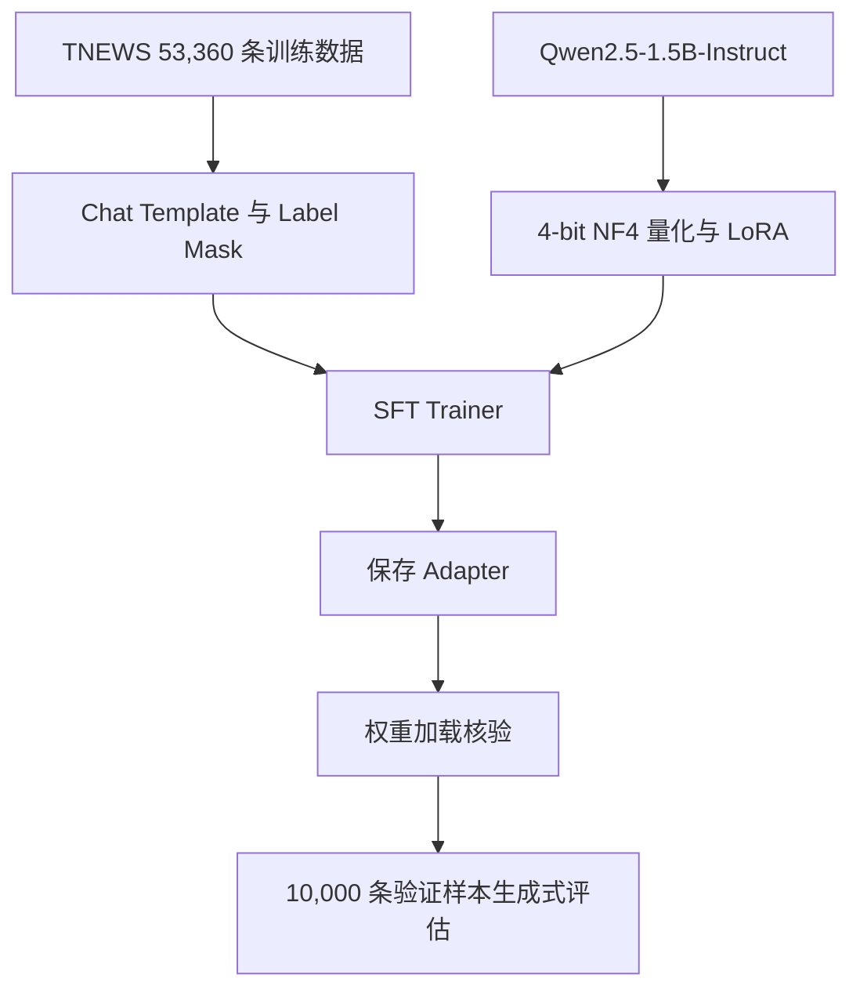

# Qwen2.5-1.5B QLoRA 中文新闻分类微调

基于 CLUE TNEWS 的生成式新闻分类实验：使用 4-bit NF4 量化与 LoRA，在本地单卡 6GB 显存条件下完成训练和离线评估。

## 历史实验结果

| 指标 | Base | 完整数据 QLoRA |
|---|---:|---:|
| Accuracy | 56.30% | 58.96% |
| Macro F1（报告舍入值） | 0.50 | 0.54 |
| Weighted F1（报告舍入值） | 0.57 | 0.59 |
| 验证样本数 | 10,000 | 10,000 |

Accuracy 提升 2.66 个百分点。历史分类报告包含未匹配输出类别“其他”（真实样本数为 0）；F1 采用原报告舍入值。此处为原 Notebook 的真实保存结果，并非本公开版重新训练的结果。

## 方法



- 15 类新闻标题分类转为条件文本生成；system/user prompt 的 labels 设为 -100，仅监督答案及其结束标记。
- 4-bit NF4，compute dtype FP16；LoRA r=16、alpha=32、dropout=0.05，注入 q/k/v/o_proj。
- 原完整训练配置：3 epochs、batch size 4、梯度累积 4、学习率 2e-4、BF16 Trainer；训练 10,005 步，日志 training loss 0.339725。
- 推理使用 greedy generation（max_new_tokens=5），按历史类别顺序匹配输出，无法匹配则为“其他”。

## Adapter 排查

历史 Notebook 曾出现重复注入 PEFT 的警告，权重键存在重复 `base_model.model.` 前缀。对单个 LoRA B 张量检查发现加载值为零，与磁盘训练权重最大差异约 0.13735。随后核对名称和形状，将 224 个权重张量映射到模型，修复后最大差异为 0；保存修复后的 Adapter，再完成全量验证。

`src/repair_adapter.py` 是针对该前缀问题的离线整理工具；`src/verify_adapter.py` 用于重新加载后逐张量核对。历史修复实际使用的是模型内参数复制后重新保存，不能将新工具视为已经执行过的历史复现实验。

## 使用说明

数据来源：[CLUE TNEWS](https://huggingface.co/datasets/clue/clue)；基座：[Qwen2.5-1.5B-Instruct](https://huggingface.co/Qwen/Qwen2.5-1.5B-Instruct)。本仓库不分发数据集或模型权重，请遵守各自许可。

在仓库根目录运行。先按硬件安装 CUDA 兼容的 PyTorch，再安装 `requirements.txt` 中依赖。该版本表是 2026-11-24 本机查询结果，不代表训练时的完整依赖锁定；本整理版未验证跨机器兼容性。

```bash
pip install -r requirements.txt
python -m src.evaluate --help
python -m src.train --help
```

已有自己训练的 Adapter 时，可检查实际重新加载的权重，随后对前 20 条验证样本试运行：

```bash
python -m src.verify_adapter --adapter /path/to/adapter
python -m src.evaluate --adapter /path/to/adapter --limit 20
```

不传 `--adapter` 则评估 Base；不传 `--limit` 则运行全部验证集。训练脚本提供 `--smoke`，仅做一轮优化器更新的冒烟测试（不等价于完整历史训练）：

```bash
python -m src.train --output outputs/smoke --smoke
```

## 复现边界

历史 Notebook 有多次试验和重复 PEFT 注入，无法保证初始状态与新脚本完全一致。`src/train.py` 为从干净基座开始的规范化训练参考，新增 prompt 前缀检查并避免重复注入；尚未通过 GPU 训练、完整推理或全量重训验证。历史指标与新代码的未来结果须分开报告。`configs/training.json` 记录历史参数，不是运行时配置文件。

本项目是低显存量化微调与本地生成式评估实验，不涉及生产级推理部署、剪枝或推理加速压测。

## 本地运行验证（2026-11-24）

在 Windows、单卡 GPU 环境下完成公开版代码的运行验证：

- 训练及评估命令入口检查通过。
- 4-bit Qwen 基座模型加载成功。
- 已训练 Adapter 权重核验通过，224 个张量最大绝对误差为 0。
- 完成前 20 条验证样本的推理冒烟测试，Accuracy 为 70%。

本次未重新训练模型，也未重新评估完整验证集。
上述冒烟测试不替代原始 10,000 条验证样本的正式实验结果。
